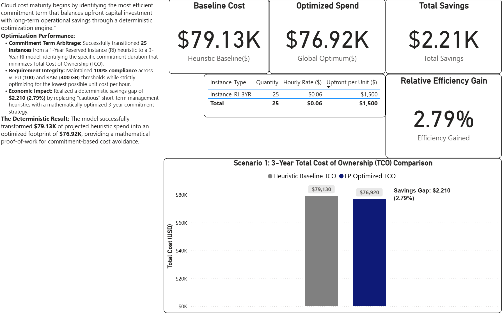
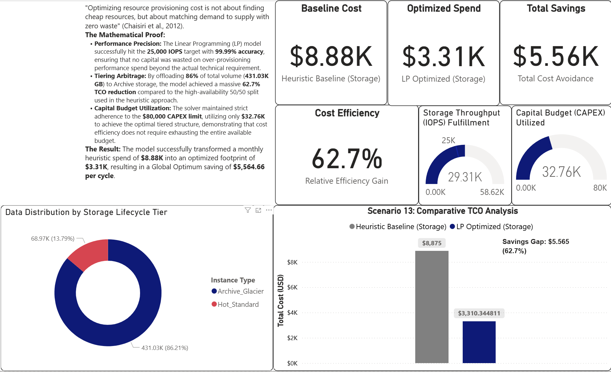
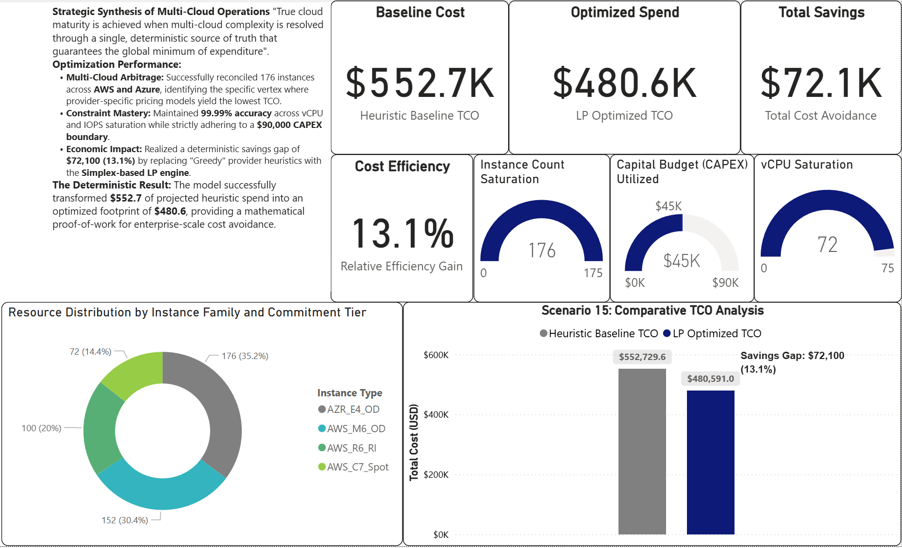

# Cloud Cost Optimization Engine

**Linear programming for multi-cloud cost allocation: find the cheapest mix of
AWS and Azure resources that still meets every technical, budget and policy
constraint, and show how much a rule-of-thumb approach leaves on the table.**

[](https://github.com/fruchesko/Cloud-Cost-Optimization-Engine/actions/workflows/tests.yml)


Engineer's thesis project (B.Sc. ICT, Bydgoszcz University of Science and
Technology, 2026), extended into a working web app with an AI assistant.

---

## 🔗 Try it live

| Demo | What you can do |
|---|---|
| **[Optimization engine](https://lair-server.taild34a63.ts.net/)** | Pick a scenario, change the demand, budget and policy inputs, press Solve and compare the rule-of-thumb baseline with the optimum. The **Needs assistant** chat on the page turns a plain-language description ("we run 300 vCPUs, half must be on Azure…") into suggested settings. |
| **[API docs](https://lair-server.taild34a63.ts.net/docs)** | The same engine as a JSON API (`GET /scenarios`, `POST /solve`), with interactive Swagger docs. |
| **[AI gateway chat](https://lair-server.taild34a63.ts.net:8443/)** | A LibreChat front end on a self-hosted LiteLLM gateway, with Claude and GPT models behind one budget-capped endpoint. Login details are available on request. |

Both demos run on a small home server published through Tailscale Funnel,
so they may occasionally be offline. Every account and API key has a hard spending
cap, and requests are rate-limited.

---

## 🎯 The problem

Cloud bills are shaped by many interacting choices: On-Demand vs Reserved vs
Spot pricing, instance shapes, storage tiers, upfront (CAPEX) budgets, risk
appetite and provider policies. Most tooling and most people optimise these
one at a time with greedy rules ("reserve the baseline", "keep everything
hot"). Each rule saves money locally, but together they miss the global
optimum, and sometimes they break a constraint outright.

This engine models each problem as a **linear program** (PuLP with the CBC
solver). It minimises total cost of ownership subject to every constraint at
once, and reports:

- the cost of a **heuristic baseline** (the rule of thumb a team would apply by hand)
- the cost of the **optimal** allocation and the savings
- which instances or tiers to buy, and how many
- which constraints are **binding**, meaning they are the ones actually limiting the cost

## 📊 Results

All numbers come from the code in this repository (`code/Main.py` writes them
to a CSV; the tests in `tests/` assert the headline figures).

| Scenario | Baseline | Optimum | Savings |
|---|---:|---:|---:|
| 1. Rate optimisation (OD vs 1-yr vs 3-yr RI, 3-year TCO) | $79,130 | $76,920 | **2.8%** |
| 6. Financial right-sizing under a $25K CAPEX cap | $262,800 | $182,524 | **30.5%** |
| 13. Storage tiering and migration, 500 TB (per month) | $8,875 | $3,310 | **62.7%** |
| 15. Multi-cloud master problem (3-year TCO) | $552,730 | $480,591 | **13.1% ($72,139)** |

A Scenario 15 solve takes about 0.01 s, so the engine is fast enough for
interactive what-if analysis.

### Scenario 1: Rate optimisation
Cover a steady 100 vCPU workload with the cheapest mix of On-Demand and
Reserved Instances. The optimum is 25 three-year Reserved Instances, against the
baseline's one-year reservations.



### Scenario 13: Storage lifecycle and migration
Place 500 TB across Hot, Cool and Archive tiers so that the data still delivers
25,000 IOPS and the one-time migration fee stays under $80K. The baseline puts
half in Hot and half in Cool. The optimum keeps about 69 TB in Hot for IOPS and
moves the rest to Archive, which cuts the monthly bill by 62.7%. Its migration
costs $28.4K, against $112.5K for the baseline split.



### Scenario 15: The integrated master problem
vCPU, RAM and IOPS demand across AWS and Azure, subject to:
- a $45K upfront budget
- a ceiling of 15% on Spot capacity
- a policy that at least 35% of vCPUs run on Azure

The siloed baseline sizes only for vCPUs and never uses Spot. The optimum spends
the whole CAPEX budget on AWS Reserved, keeps the Azure share on memory-heavy
instances, and uses Spot up to the risk ceiling.



The full thesis (all 15 scenarios, method and discussion) is in
[`docs/`](docs/), together with the Power BI dashboard (`.pbix`).

---

## 🧠 How it's built

```
engine/   Scenarios 1, 13, 15 as pure functions: inputs as parameters (thesis
          values as defaults) → structured result (costs, choices, binding constraints)
app/      FastAPI web app and JSON API on top of engine/
          - pydantic validation with a min/max for every input
          - each solve runs in a subprocess with a hard timeout
          - per-visitor rate limits, security headers (CSP, HSTS), 64 KB body cap
          - Needs assistant: an LLM call with a tool schema; its suggestions are
            validated against the same ranges as /solve before the page offers them
tests/    pytest suite (engine numbers, API validation, infeasible inputs,
          timeouts, security headers, assistant with a fake model); runs in CI
code/     the original thesis scripts for all 15 scenarios (unchanged logic)
docs/     thesis PDF and Power BI dashboard
visuals/  dashboard screenshots
```

### The AI gateway behind the demos
The Needs assistant and the chat demo both call models through a self-hosted
**LiteLLM** gateway rather than calling providers directly. It provides:

- **One endpoint for every model:** Claude Opus, Sonnet and Haiku plus GPT models,
  with fallbacks between providers when one is unavailable.
- **Spending caps:** separate budgets per person and per application key, a
  monthly cap per provider and a global cap.
- **PII masking:** emails, phone numbers, IBANs, card numbers and cloud or API
  keys are masked before a prompt leaves the server.
- **Isolation:** the gateway is not reachable from the internet. Only the web app
  and the chat front end are published, and both sit behind TLS and security
  headers.

The assistant uses a small, cheap model (`gpt-6-luna`) and is limited to 20
messages per visitor per hour.

---

## 🛠️ Run it yourself

### Web app (Docker)
```bash
git clone https://github.com/fruchesko/Cloud-Cost-Optimization-Engine.git
cd Cloud-Cost-Optimization-Engine
docker compose up -d --build          # then open http://localhost:8090
```
The compose file expects an external Docker network called `ai-poc`, which is
the one the LiteLLM gateway runs on. On a machine without the gateway, create
the network once with `docker network create ai-poc`.

### Web app (Python)
```bash
python3 -m venv .venv && source .venv/bin/activate
pip install -r requirements-app.txt
uvicorn app.main:app --port 8090
```

The Needs assistant is optional. To turn it on, put a LiteLLM (OpenAI-compatible)
key in `.env` as `LITELLM_API_KEY`; see `.env.example`. Without a key the
assistant is hidden and everything else works.

| Endpoint | |
|---|---|
| `GET /scenarios` | scenarios with each parameter's range and default |
| `POST /solve` | `{"scenario": "scenario_15", "params": {"max_capex": 60000}}`; omitted parameters use the thesis values |
| `POST /assistant` | chat messages in, reply plus a validated settings suggestion out |
| `GET /docs` | interactive API documentation |

`/solve` returns 422 `"infeasible"` when no allocation meets the constraints,
422 with field details for out-of-range inputs, and 504 if the solver exceeds
`SOLVER_TIMEOUT_SECONDS` (default 10).

### Tests
```bash
pip install -r requirements-dev.txt && pytest
```

### Original thesis scripts (all 15 scenarios)
```bash
pip install -r requirements.txt
cd code && python Main.py             # writes Diploma_Optimization_Results_FINAL.csv
```
This also runs in Google Colab: upload `requirements.txt` and the `code/*.py`
files, then run `!pip install -r requirements.txt` followed by `!python Main.py`.

---

## ⚠️ Scope and limitations

- This is a **mathematical proof of concept**. Workloads are synthetic, priced
  with AWS and Azure list prices. It has not been validated against real
  production billing data, which has tagging gaps, anomalies and discounts that
  are not modelled here.
- Each baseline is a deliberately simple rule of thumb, taken from the thesis.
  Savings measure the gap to that rule, not to a skilled FinOps team.
- `code/scenario_07.py` (Spot risk vs technical fit) currently contains a copy of
  Scenario 6, so the Scenario 7 thesis results can't be reproduced from this
  repository.

## 👤 Author

**Kyrylo Brykov**, B.Sc. Information and Communication Technology,
Bydgoszcz University of Science and Technology (Politechnika Bydgoska), 2026.
Interests: optimisation, cloud FinOps, AI platform engineering and BI analytics.

MIT License, see [LICENSE](LICENSE).
